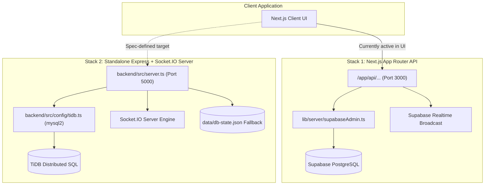
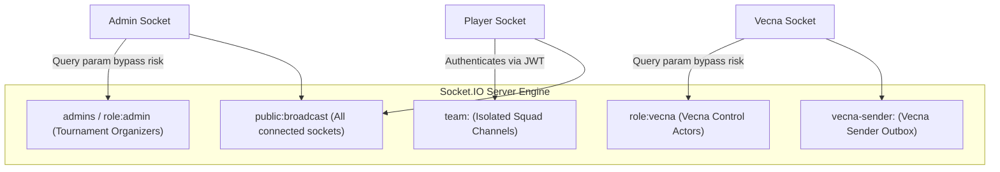
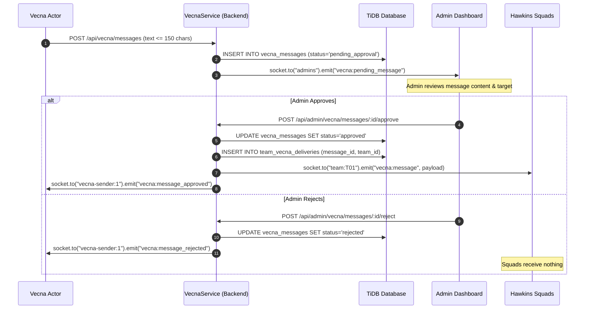

# Backend, Database & Socket.IO Audit — The Hawkins Protocol

**Audited Repository**: `c:\Users\nilot\OneDrive\Desktop\STRANGERS THING NIL`  
**Audit Date**: October 10, 2026  
**Auditor**: Backend & Database & Realtime Auditor Subagents  
**Status**: Strictly Read-Only Inspection  

---

## 1. Executive Summary & Architecture Dual-Stack Inventory

The repository currently contains **two distinct backend stacks**:



### Critical High-Level Findings:
1. **Unsynchronized Backends**: The Next.js frontend currently sends submissions and heartbeats to Next.js API routes (Supabase), while the newly constructed Express backend (`backend/src`) implements the tournament specification with TiDB and Socket.IO on port 5000.
2. **Missing Auth Middleware on Admin Endpoints**:
   - Next.js Admin routes (`/api/admin/*`) perform **zero token verification**.
   - Express Admin routes (`backend/src/routes/admin.routes.ts`) omit `requireAuth(["ADMIN"])`, exposing raw secret answers (`GET /api/admin/chapters`) and score manipulation endpoints publicly.
3. **Broken Object Level Authorization (BOLA)**: Express `specGame.controller.ts` derives team identity from query strings or request bodies (`req.query.teamId || req.body.teamId`), allowing any squad to submit answers or consume hint penalties for competitors.
4. **Permissive Fallback & Hardcoded Passkeys**:
   - `AnswerValidationService.ts` contains a fallback returning `true` for answers `"a"` or `"run"` if database verification encounters an error.
   - `app/api/admin/login/route.ts` hardcodes `"1234567"` bypass passkey.
5. **Database Transaction Gaps**:
   - `QuestionService.submitAnswer`, `QuestionService.useHint`, and `VecnaService.approveMessage` execute multiple dependent SQL queries sequentially without explicit database transactions (`START TRANSACTION` / `COMMIT`), creating race condition and data inconsistency risks.

---

## 2. API Routes & Controller Matrix

### 2.1 Next.js App Router API Routes (`app/api/*`)

| Endpoint | Method | Role / Auth Guard | Data Access / Tables | Real vs Mock | Security & Integrity Assessment | Classification |
|---|---|---|---|---|---|---|
| `/api/auth/login` | `POST` | Public (Checks `event_state.login_open`) | Reads `teams`, `event_state`; inserts `active_sessions` | `[REAL]` (Supabase) | Single session enforced. Accepts squad leader name as plaintext password fallback. Sets 24h HTTP-only cookie. | `[COMPLETE / WORKING]` `[SECURITY / INTEGRITY RISK]` |
| `/api/auth/logout` | `POST` | Authenticated (`hawkins_session_token`) | Deletes from `active_sessions` | `[REAL]` (Supabase) | Clears session cookie and deletes active session record. | `[COMPLETE / WORKING]` |
| `/api/auth/session` | `GET` | Authenticated (`getAuthenticatedTeam`) | Updates `active_sessions.last_heartbeat`; reads `team_submissions`, `team_hint_usage`, `event_state`, `vecna_sabotages` | `[REAL]` (Supabase) | Computes remaining freeze duration; returns score and stage telemetry. | `[COMPLETE / WORKING]` |
| `/api/admin/login` | `POST` | Passkey check | None | `[SECURITY / INTEGRITY RISK]` | **CRITICAL**: Accepts hardcoded bypass passkey `"1234567"`. Returns unverified cookie token. | `[BROKEN / BUGGY]` `[SECURITY / INTEGRITY RISK]` |
| `/api/admin/event/state` | `GET`, `PATCH` | **None (Missing Auth)** | Reads/Updates `event_state` (id: 1) | `[REAL]` (Supabase) | **CRITICAL**: Unauthenticated caller can pause/stop/open submissions for the tournament. | `[SECURITY / INTEGRITY RISK]` |
| `/api/admin/teams` | `GET` | **None (Missing Auth)** | Reads all `teams`, `active_sessions`, `team_submissions` | `[REAL]` (Supabase) | **CRITICAL**: Publicly dumps all plaintext passwords (`password_plain`), squad leader names, and IP addresses. | `[SECURITY / INTEGRITY RISK]` |
| `/api/admin/teams/force-logout` | `POST` | **None (Missing Auth)** | Deletes from `active_sessions`; broadcasts `force_logout` | `[REAL]` (Supabase) | **CRITICAL**: Any anonymous client can terminate any squad's session. | `[SECURITY / INTEGRITY RISK]` |
| `/api/admin/teams/import` | `POST` | **None (Missing Auth)** | Upserts into `teams` | `[REAL]` (Supabase) | **CRITICAL**: Any caller can overwrite tournament squad rosters and credentials. | `[SECURITY / INTEGRITY RISK]` |
| `/api/admin/teams/reset-all-sessions` | `POST` | **None (Missing Auth)** | Deletes all records in `active_sessions` | `[REAL]` (Supabase) | **CRITICAL**: Unauthenticated caller can disconnect every active squad. | `[SECURITY / INTEGRITY RISK]` |
| `/api/questions/submit` | `POST` | Authenticated (`getAuthenticatedTeam`) | Reads `question_answers`; inserts `team_submissions`; updates `teams` | `[REAL]` (Supabase) | Server-side validation. Enforces round progression and freeze checks. Handles unique constraint conflict `23505`. | `[COMPLETE / WORKING]` |
| `/api/hints/use` | `POST` | Authenticated (`getAuthenticatedTeam`) | Reads `question_hints`; inserts `team_hint_usage` | `[REAL]` (Supabase) | Idempotent hint reveals. Deducts points server-side on first unlock. | `[COMPLETE / WORKING]` |
| `/api/leaderboard` | `GET` | Public | Reads `teams` ordered by `total_score DESC` | `[REAL]` (Supabase) | Sanitized leaderboard standings. | `[COMPLETE / WORKING]` |
| `/api/vecna/sabotage` | `POST` | **None (Missing Auth)** | Inserts `vecna_sabotages`; broadcasts over Realtime | `[REAL]` (Supabase) | **CRITICAL**: Unauthenticated public caller can broadcast infinite `TIME_FREEZE` locking all teams. | `[SECURITY / INTEGRITY RISK]` |
| `/api/vecna/status` | `GET` | Authenticated (`getAuthenticatedTeam`) | Reads `vecna_sabotages`, `vecna_deliveries` | `[REAL]` (Supabase) | Fetches active sabotages and story deliveries. | `[COMPLETE / WORKING]` |

---

### 2.2 Express Standalone API Routes (`backend/src/routes/*`)

| Endpoint | Method | Controller Handler | Auth Middleware | Input Validation | Classification & Security Analysis |
|---|---|---|---|---|---|
| `/api/auth/login` | `POST` | `AuthController.login` | Public | Custom (`teamName`, `leaderName`) | `[COMPLETE / WORKING]` Verifies squad credentials, creates single session in TiDB (`team_active_sessions`), signs JWT. |
| `/api/auth/logout` | `POST` | `AuthController.logout` | `requireAuth()` | None | `[COMPLETE / WORKING]` Deletes active session from TiDB; records in `team_session_audit`. |
| `/api/auth/admin-login` | `POST` | `AuthController.adminLogin` | Passkey comparison | Custom (`passkey`) | `[COMPLETE / WORKING]` Validates `ADMIN_PASSKEY`; generates Admin JWT. |
| `/api/auth/me` | `GET` | `AuthController.getMe` | `requireAuth()` | None | `[COMPLETE / WORKING]` Returns verified session object. |
| `/api/admin/chapters` | `GET` | `AdminController.getChapters` | **None (Omitted)** | None | `[SECURITY / INTEGRITY RISK]` **CRITICAL**: Returns raw questions with secret answers (`correctAnswer: "A"`). |
| `/api/admin/chapters/:id` | `PUT`, `DELETE` | `AdminController.update/deleteChapter` | **None (Omitted)** | Custom fields | `[SECURITY / INTEGRITY RISK]` **CRITICAL**: Unauthenticated modification/deletion of questions. |
| `/api/admin/teams` | `GET`, `POST` | `AdminController.getTeams/createTeam` | **None (Omitted)** | Custom fields | `[SECURITY / INTEGRITY RISK]` **CRITICAL**: Unauthenticated team roster management. |
| `/api/admin/teams/:id/score`| `PUT` | `AdminController.updateTeamScore` | **None (Omitted)** | Custom (`points`) | `[SECURITY / INTEGRITY RISK]` **CRITICAL**: Direct manual team score override. |
| `/api/admin/event/*` | `POST` | `AdminController.start/pause/resume/end` | **None (Omitted)** | None | `[SECURITY / INTEGRITY RISK]` **CRITICAL**: Unauthenticated event lifecycle control. |
| `/api/admin/vecna/messages/:id/approve` | `POST` | `AdminController.approveVecnaMessage` | **None (Omitted)** | Param check | `[SECURITY / INTEGRITY RISK]` **CRITICAL**: Unauthenticated approval of queued Vecna messages. |
| `/api/event/state` | `GET` | `SpecGameController.getEventState` | Public | None | `[COMPLETE / WORKING]` Public event state snapshot. |
| `/api/me/progress` | `GET` | `SpecGameController.getMyProgress` | **Unverified query/body** | Fallback to `"T01"` | `[SECURITY / INTEGRITY RISK]` **BOLA**: Allows viewing progress of any squad via `?teamId=...`. |
| `/api/questions/:code/submit` | `POST` | `SpecGameController.submitAnswer` | **Unverified query/body** | Custom | `[SECURITY / INTEGRITY RISK]` Validates HMAC answer against TiDB, but accepts arbitrary `teamId` from body. |
| `/api/questions/:code/hints/:id/use` | `POST` | `SpecGameController.useHint` | **Unverified query/body** | Param checks | `[SECURITY / INTEGRITY RISK]` Deducts penalty in `score_ledger`, but accepts arbitrary `teamId` from body. |
| `/api/me/vecna-messages` | `GET` | `SpecGameController.getMyVecnaMessages`| **Unverified query/body** | None | `[SECURITY / INTEGRITY RISK]` BOLA vulnerability on team message inbox. |
| `/api/chapters` | `GET` | `ChaptersController.getSanitizedChapters` | Public | None | `[COMPLETE / WORKING]` Strips `correctAnswerId` safely. |
| `/api/chapters/validate` | `POST` | `ChaptersController.validateChapter` | Rate limited (45/min) | Custom fields | `[SECURITY / INTEGRITY RISK]` Validates answers against vault, but accepts arbitrary `teamId`. |
| `/api/radiometer/validate-pin` | `POST` | `RadiometerController.validatePin` | Rate limited (45/min) | Custom (`pinIndex`, `answer`) | `[COMPLETE / WORKING]` Server-side pin validation against `[8, 3, 4, 7, 9]`. |
| `/api/radiometer/validate-keypad`| `POST` | `RadiometerController.validateKeypad`| Rate limited (45/min) | Custom (`code`) | `[COMPLETE / WORKING]` Validates master code `83479`. |
| `/api/tasks/hint/unlock` | `POST` | `TasksController.unlockHint` | **None** | Custom (`cost`) | `[SECURITY / INTEGRITY RISK]` **CRITICAL**: Accepts penalty cost from client (`cost: 0` bypasses deduction). |
| `/api/vecna/messages` | `POST` | `VecnaController.submitMessage` | Public / Sender check | 1–150 chars | `[COMPLETE / WORKING]` Inserts message into `pending_approval` queue; notifies admins via Socket.IO. |

---

## 3. Database Schema & Migration Audit

### 3.1 Schema Comparison: TiDB DDL vs Supabase PostgreSQL DDL

| Specification Requirement | TiDB DDL (`backend/database/tidb_schema.sql`) | Supabase DDL (`backend/database/migration_prod.sql`) | Compliance Status |
|---|---|---|---|
| **Rounds / Chapters Schema** | `rounds` (id, code, title, order_num, is_active) | Hardcoded numbers in `question_answers.round_number` | TiDB fully compliant; Supabase partially compliant. |
| **Questions Schema** | `questions` (id, round_id, question_code, prompt_markdown, points, order_num) | `question_answers` (question_id, round_number, prompt, points, correct_answer) | TiDB compliant; Supabase stores plaintext answers in `question_answers`. |
| **Answer Key Secrecy** | `question_answer_keys` (accepted_answer_hmac HMAC-SHA256) | Plaintext `correct_answer` & `accepted_answers[]` in `question_answers` | TiDB uses cryptographically secure HMAC; Supabase stores cleartext. |
| **Hints & Penalties** | `hints` (id, question_id, hint_code, penalty_cost) | `question_hints` (hint_id, question_id, hint_number, deduction) | Both implement penalty accounting. |
| **Score Ledger** | `score_ledger` (immutable append-only table: id, team_id, delta, source_type, source_id) | `teams.total_score` mutable integer column | TiDB implements immutable financial-grade ledger; Supabase uses mutable score. |
| **Single Active Session** | `team_active_sessions` (`team_id` PRIMARY KEY) | `active_sessions` (`team_id` UNIQUE constraint) | Both strictly enforce single active session at schema level. |
| **Vecna Approval Pipeline** | `vecna_messages` (`status` ENUM `pending_approval`, `approved`, `rejected`) + `team_vecna_deliveries` | `vecna_sabotages` (mutable direct execution) + `vecna_deliveries` | TiDB implements authoritative 2-step approval workflow. |

---

### 3.2 TiDB Table Inventory & Constraints Analysis

```
+---------------------------+-----------------------------------+-----------------------------------+
| Table Name                | Primary Key                       | Unique / Foreign Key Constraints  |
+---------------------------+-----------------------------------+-----------------------------------+
| events                    | id INT AUTO_INCREMENT            | None                              |
| admin_users               | id INT AUTO_INCREMENT            | UNIQUE(username)                  |
| teams                     | id VARCHAR(32)                    | UNIQUE(team_name)                 |
| team_active_sessions      | team_id VARCHAR(32)               | FK(team_id -> teams.id)           |
| team_session_audit        | id BIGINT AUTO_INCREMENT          | FK(team_id -> teams.id)           |
| rounds                    | id INT AUTO_INCREMENT            | UNIQUE(round_code)                |
| questions                 | id INT AUTO_INCREMENT            | UNIQUE(round_id, question_code)   |
| question_answer_keys      | id INT AUTO_INCREMENT            | INDEX(question_id, answer_hmac)   |
| hints                     | id INT AUTO_INCREMENT            | UNIQUE(question_id, hint_code)    |
| team_round_progress       | id BIGINT AUTO_INCREMENT          | UNIQUE(team_id, round_id)         |
| question_submissions      | id BIGINT AUTO_INCREMENT          | UNIQUE(team_id, question_id)      |
| team_hint_usages          | id BIGINT AUTO_INCREMENT          | UNIQUE(team_id, hint_id)          |
| score_ledger              | id BIGINT AUTO_INCREMENT          | FK(team_id -> teams.id)           |
| vecna_senders             | id INT AUTO_INCREMENT            | UNIQUE(sender_code)               |
| vecna_sender_sessions     | id INT AUTO_INCREMENT            | UNIQUE(vecna_sender_id)           |
| vecna_templates           | id INT AUTO_INCREMENT            | None                              |
| vecna_messages            | id BIGINT AUTO_INCREMENT          | FK(sender_id -> vecna_senders.id) |
| team_vecna_deliveries     | id BIGINT AUTO_INCREMENT          | UNIQUE(message_id, team_id)       |
| admin_audit_log           | id BIGINT AUTO_INCREMENT          | FK(admin_id -> admin_users.id)    |
+---------------------------+-----------------------------------+-----------------------------------+
```

### 3.3 Critical SQL Transaction & Query Vulnerabilities

1. **Missing SQL Transactions in Services**:
   - In `backend/src/services/question.service.ts` (`submitAnswer`), the function performs:
     1. `INSERT INTO question_submissions ...`
     2. `INSERT INTO score_ledger ...`
     3. Check completion -> `INSERT INTO team_round_progress ...`
     4. `INSERT INTO admin_audit_log ...`
   - **Vulnerability**: These queries run sequentially without `connection.beginTransaction()` / `commit()`. If the server crashes or the network drops during step 2 or 3, the team will have a recorded submission with **zero score awarded** and a locked question.
2. **Cartesian Product in Results Export**:
   - In `EventControlService.getOverallResults` (`eventControl.service.ts`), the query executes:
     ```sql
     SELECT t.id, t.team_name, ...
     FROM teams t
     LEFT JOIN score_ledger sl ON sl.team_id = t.id
     LEFT JOIN question_submissions qs ON qs.team_id = t.id
     LEFT JOIN team_hint_usages hu ON hu.team_id = t.id
     GROUP BY t.id, t.team_name, ...
     ```
   - **Flaw**: Joining multiple one-to-many child tables (`score_ledger`, `question_submissions`, `team_hint_usages`) without pre-aggregating in subqueries generates a **Cartesian product**, multiplying the ledger count and distorting score sums.

---

## 4. Realtime & Socket.IO Architecture Audit

### 4.1 Room Topology & Authorization



### 4.2 Room Access Vulnerability
- In `backend/src/services/socket.service.ts` (Lines 87–93):
  ```typescript
  if (socket.handshake.query?.role === "ADMIN") {
    socket.join("admins");
    socket.join("role:admin");
  }
  ```
- **Vulnerability**: Any unauthorized client connecting with `io("http://localhost:5000", { query: { role: "ADMIN" } })` is immediately admitted to the privileged `admins` room, allowing them to intercept pending Vecna submissions, live telemetry, and audit logs.

### 4.3 Vecna 2-Step Approval Queue Lifecycle



- **Compliance**: The Express backend implementation in `vecna.service.ts` **fully satisfies** the required 2-step approval architecture.
- **Offline Recipient Guarantee**: Delivered messages are persisted to `team_vecna_deliveries`. When an offline squad reconnects, `SpecGameController.getMyVecnaMessages` retrieves all pending and delivered messages from TiDB.

---

## 5. Remediation & Consolidation Roadmap

1. **Mount Authentication Middleware on Express Routes**:
   - Apply `requireAuth(["ADMIN"])` to `backend/src/routes/admin.routes.ts`.
   - Apply `requireAuth(["PLAYER"])` to `backend/src/routes/specGame.routes.ts` and bind `teamId = req.user.teamId`.
2. **Implement SQL Database Transactions**:
   - Wrap `QuestionService.submitAnswer`, `QuestionService.useHint`, and `VecnaService.approveMessage` in `const conn = await tidb.pool.getConnection(); await conn.beginTransaction(); ... await conn.commit();`.
3. **Fix Cartesian Join in EventControlService**:
   - Refactor `getOverallResults` to aggregate `score_ledger` and `question_submissions` in separate subqueries prior to joining.
4. **Authenticate Socket.IO Handshakes**:
   - Verify the `token` header/auth object using `AuthService.verifyToken()` in `io.use()` middleware before permitting connection or joining privileged rooms.
5. **Remove Insecure Answer Fallback**:
   - Remove lines 78–81 in `backend/src/services/answerValidation.service.ts` accepting `"a"` / `"run"`.
