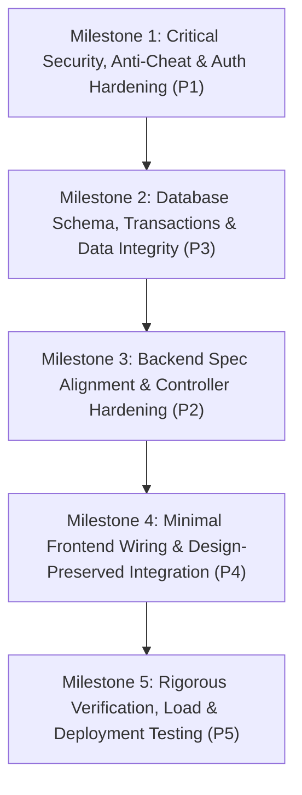

# The Hawkins Protocol — Master Remediation Plan

**Project**: The Hawkins Protocol (Stranger Things Event Platform)  
**Document Status**: Planning Only — Strict Design Freeze Maintained  
**Target Architecture**: Next.js (Approved UI Design on Vercel) + Node.js Express Backend (Persistent Host: Render/Railway) + TiDB Serverless + Socket.IO  
**Audit Baseline**: Findings from `PROJECT_AUDIT_REPORT.md`, `FRONTEND_FEATURE_AUDIT.md`, `BACKEND_DATABASE_SOCKET_AUDIT.md`, and `ORGANIZER_INPUTS_AND_DECISIONS.md`  

---

## 1. Architectural Strategy & Frontend Design Freeze Policy

### 1.1 Absolute Frontend Design Freeze
The approved retro 1980s visual design, CRT scanline effects, layout structures, sound design, animations, typography, color palettes, and corkboard investigation interactions are **100% frozen**.
- **No Visual Modifications**: No pages, modals, cards, HUD elements, banners, buttons, typography, or styling will be altered, replaced, or restyled.
- **Minimal Surgical Backend Wiring**: Any frontend change is strictly limited to data-fetching bindings inside `lib/api.ts`, `lib/store.tsx`, and `lib/realtime.ts` (redirecting network calls from Next.js Supabase routes to the standalone Express/TiDB backend on Port 5000).
- **Security-Driven UI Protections**: Removing the non-production `[DEMO AUTO-SOLVE]` button in `QuestionTypeRenderer.tsx` and removing the fallback auto-solve line in `HopperPoliceReportQuiz.tsx` are the **only** UI changes proposed, preserving the exact visual quiz card structure.

### 1.2 Single Authoritative Backend Unification
All runtime state, team sessions, progress tracking, question sanitization, HMAC answer checking, hint deduction accounting, score calculation, admin moderation, and Vecna messaging will be authoritatively hosted on the **Standalone Express + TiDB + Socket.IO server (`backend/src`)**.
- Next.js App Router API routes (`app/api/*`) and Supabase PostgreSQL services (`lib/supabaseService.ts`, `lib/server/supabaseAdmin.ts`) will be retired/decoupled to eliminate conflicting data stores and duplicate session tracking.

---

## 2. Remediation Milestones & Phased Roadmap



---

### Milestone 1: Critical Security, Anti-Cheat & Auth Hardening (P1)
**Goal**: Eliminate all answer leakage, close unauthenticated admin/sabotage endpoints, secure WebSocket room handshakes, and enforce true single-session revocation.

- **M1.1 — Answer Key Secrecy & Client Bundle Sanitization**:
  - Strip `correctAnswerId`, `correctOrder`, and plaintext solution hints from `lib/chapterQuestions.ts`, `lib/tasks.ts`, and `lib/radiometer.ts`.
  - Provide a clean TypeScript interface (`SanitizedQuestion`) containing only `id`, `chapterId`, `title`, `prompt`, `type`, `options`, `points`, `hasHint`, and `hintPenalty`.
  - Remove the development `[DEMO AUTO-SOLVE]` button in `QuestionTypeRenderer.tsx` and the auto-fill fallback in `HopperPoliceReportQuiz.tsx` (Line 154).
- **M1.2 — Insecure Fallback & Backdoor Removal**:
  - Remove permissive answer fallback in `backend/src/services/answerValidation.service.ts` (Lines 78–81) that returns `true` for `"a"` / `"run"`.
  - Remove hardcoded admin bypass passkey `"1234567"` in `app/api/admin/login/route.ts` and ensure Express admin login relies strictly on `ENV.ADMIN_PASSKEY`.
- **M1.3 — Server-Side Route Authorization**:
  - Mount `requireAuth(["ADMIN"])` middleware across all routes in `backend/src/routes/admin.routes.ts`.
  - Mount `requireAuth(["PLAYER"])` middleware on `backend/src/routes/specGame.routes.ts` and bind team identity strictly to `req.user.teamId` (ignoring unverified `req.query.teamId` and `req.body.teamId`).
  - Protect `backend/src/routes/vecna.routes.ts` ensuring sender ID is extracted from authenticated Vecna JWTs.
- **M1.4 — Socket.IO Handshake & Room Authorization**:
  - In `backend/src/services/socket.service.ts`, replace unverified query parameter inspection (`socket.handshake.query?.role === "ADMIN"`) with cryptographic JWT verification (`AuthService.verifyToken`) during the handshake.
  - Sockets join privileged rooms (`admins`, `role:admin`, `role:vecna`, `team:<teamId>`) only if their verified token contains the corresponding role and identifier.
  - Restrict the `socket.on("award", ...)` listener to authenticated administrators only.
- **M1.5 — Stateful Token Validation on Force Logout**:
  - In `backend/src/middleware/auth.middleware.ts`, verify that `session.teamId` currently exists in `team_active_sessions` on every stateful request, ensuring administrative force-logout immediately revokes existing JWTs.
- **M1.6 — Credential Recovery & Password Security**:
  - Support the tournament requirement where administrators can assist teams with forgotten credentials by storing encrypted credentials or deterministic organizer-provisioned recovery keys rather than plaintext database fields.

---

### Milestone 2: Database Schema, Transactions & Data Integrity (P3)
**Goal**: Ensure financial-grade score accounting, atomic multi-step mutations, and clean schema constraints on TiDB Serverless.

- **M2.1 — SQL Database Transactions**:
  - In `backend/src/services/question.service.ts`: Wrap `submitAnswer` (submission insert + ledger insert + round progress update + audit log) inside an atomic `connection.beginTransaction()` / `commit()` block.
  - In `backend/src/services/question.service.ts`: Wrap `useHint` (hint usage insert + negative ledger insert) inside an atomic transaction.
  - In `backend/src/services/vecna.service.ts`: Wrap `approveMessage` (status update + delivery snapshot inserts) inside an atomic transaction.
- **M2.2 — Fix Cartesian Product in SQL Results Aggregation**:
  - Refactor `EventControlService.getOverallResults` in `backend/src/services/eventControl.service.ts` to aggregate `score_ledger`, `question_submissions`, and `team_hint_usages` in independent subqueries before joining with `teams`.
- **M2.3 — TiDB Schema & Constraint Verification**:
  - Validate all primary and unique keys in `backend/database/tidb_schema.sql` (`team_active_sessions(team_id)`, `question_submissions(team_id, question_id)`, `team_hint_usages(team_id, hint_id)`, `team_vecna_deliveries(message_id, team_id)`).
  - Verify HMAC answer seeding script (`backend/database/seed_data.mjs`) hashes all 70 question answers with `ENV.ANSWER_HMAC_SECRET`.

---

### Milestone 3: Backend Spec Alignment & Controller Hardening (P2)
**Goal**: Ensure Express controllers strictly enforce the gameplay rules, Vecna 150-char approval pipeline, and rate limiting.

- **M3.1 — Server-Side Hint Penalty Enforcement**:
  - In `backend/src/controllers/tasks.controller.ts` (`unlockHint`), retrieve the penalty deduction strictly from the server-side configuration table, removing `req.body.cost` client trust.
- **M3.2 — Vecna 2-Step Approval Queue Enforcement**:
  - Validate maximum message length of 150 characters strictly on both `VecnaController.submitMessage` and `VecnaMessagePanel.tsx`.
  - Ensure all Vecna messages enter `pending_approval` status; no message is broadcast to squad rooms without admin approval.
  - Verify offline recipient message recovery via `team_vecna_deliveries`.
- **M3.3 — Anti-Brute-Force Login Rate Limiting**:
  - Mount `express-rate-limit` (5 requests / minute per IP) across `/api/auth/login`, `/api/auth/admin-login`, and `/api/vecna/auth/login`.

---

### Milestone 4: Minimal Frontend Wiring & Design-Preserved Integration (P4)
**Goal**: Wire existing frontend state stores to the Express/TiDB backend with zero visual changes.

- **M4.1 — Unify `lib/api.ts` to Port 5000**:
  - Configure `lib/api.ts` base URL to `http://localhost:5000/api` (or `process.env.NEXT_PUBLIC_API_URL`).
  - Align payload formats for login, question submission, hint unlocks, and Vecna dispatch.
- **M4.2 — Connect `lib/store.tsx`**:
  - Point `login()`, `logout()`, `submitAnswer()`, and `unlockHint()` in `lib/store.tsx` to `lib/api.ts` Express endpoints.
  - Store the issued JWT token securely in memory/cookie and attach `Authorization: Bearer <token>` to requests.
- **M4.3 — Connect `lib/realtime.ts` to Socket.IO**:
  - Update `getSocket()` in `lib/realtime.ts` to initialize `socket.io-client` connecting to Port 5000 with the JWT auth payload.
  - Wire listeners for `vecna:message`, `sabotage:trigger`, `session:revoked`, and `event:state_changed`.
- **M4.4 — Admin Dashboard Data Binding**:
  - Update `app/admin/page.tsx` data loaders to fetch from `/api/admin/*` on Express.
  - Mask plaintext password displays and disable arbitrary score overrides.

---

### Milestone 5: Rigorous Verification, Load & Deployment Testing (P5)
**Goal**: Verify all gameplay rules, concurrent sessions, stress handling for 90 teams, and free-tier host deployment.

- **M5.1 — Full Automated Test Suite Execution**:
  - Run `backend/test-backend.js` (23 assertions) covering single-session 409 rejection, admin force-logout, HMAC submission, idempotency, hint deductions, Vecna approval, and event lifecycle.
- **M5.2 — 90-Team Concurrency & Stress Testing**:
  - Execute `backend/concurrency-test.js` scaled to 90 simulated teams making concurrent submissions and hint unlocks under 45 req/min rate limits.
- **M5.3 — Free-Tier Deployment & Production Readiness**:
  - Verify Next.js frontend builds cleanly for Vercel.
  - Verify standalone backend runs on Render/Railway persistent container with keepalive tuning (`server.maxConnections = 5000`).

---

## 3. Dependency & Task Ordering Matrix

```
+-----------------------------------------------------------------------------------------------+
| Task ID   | Task Description                                   | Prerequisite  | Complexity   |
+-----------------------------------------------------------------------------------------------+
| T-01      | Strip client answer keys & sanitize Question schema| None          | Low (Safe)   |
| T-02      | Remove demo solve UI & auto-fill fallbacks         | T-01          | Low (Safe)   |
| T-03      | Mount auth middleware on admin & specGame routes   | None          | Medium       |
| T-04      | Secure Socket.IO handshake with JWT token check    | T-03          | Medium       |
| T-05      | Implement SQL transactions in Question & Vecna svc | None          | Medium       |
| T-06      | Fix Cartesian product in results export query      | T-05          | Low          |
| T-07      | Enforce server-side hint cost in TasksController   | T-03          | Low          |
| T-08      | Add login rate limiter (5 req/min)                 | None          | Low          |
| T-09      | Connect lib/api.ts & lib/store.tsx to Express      | T-01, T-03    | Medium       |
| T-10      | Connect lib/realtime.ts to Express Socket.IO       | T-04, T-09    | Medium       |
| T-11      | Update Admin & Vecna page data bindings            | T-03, T-09    | Medium       |
| T-12      | Run automated test suite & 90-team concurrency test| T-01..T-11    | High         |
+-----------------------------------------------------------------------------------------------+
```

---

## 4. Completion & Sign-Off Criteria

The remediation will be deemed 100% complete only when:
1. **Design Freeze Verified**: Frontend visually and structurally matches 100% of approved screens.
2. **Answer Secrecy Verified**: `grep -rn "correctAnswerId" lib/ components/` returns zero hits in client bundles.
3. **Admin Auth Verified**: All unauthenticated requests to `/api/admin/*` return HTTP 401/403.
4. **Single-Session Verified**: Second login attempts with identical team credentials return HTTP 409.
5. **Score Ledger Verified**: All score increments and hint penalties match the immutable ledger sums.
6. **Vecna Pipeline Verified**: Messages <= 150 chars require admin approval before dispatch; offline squads receive backlogged deliveries upon reconnect.
7. **Load Test Passed**: 90 simulated teams submit answers simultaneously with 0 unhandled promise rejections and $< 100\text{ms}$ response latency.
